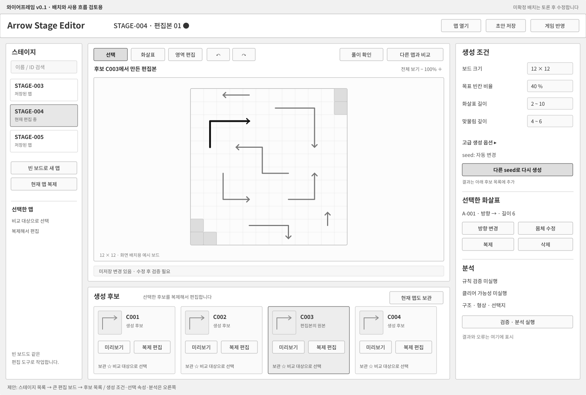
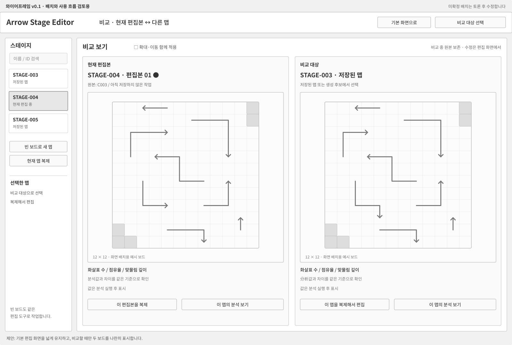
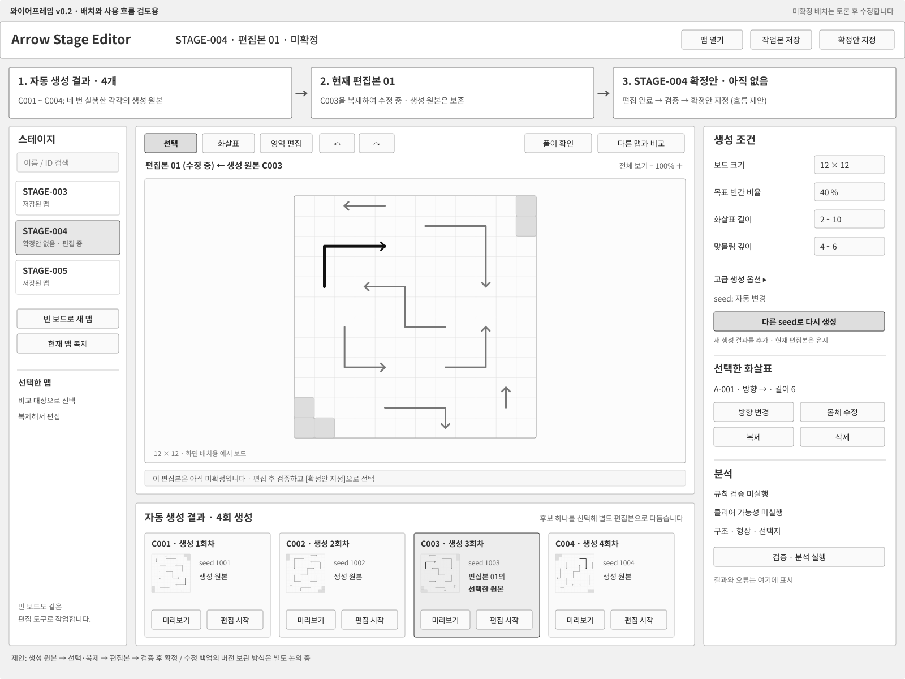
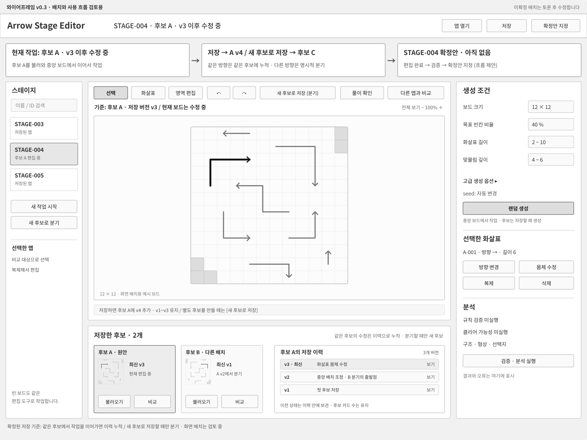
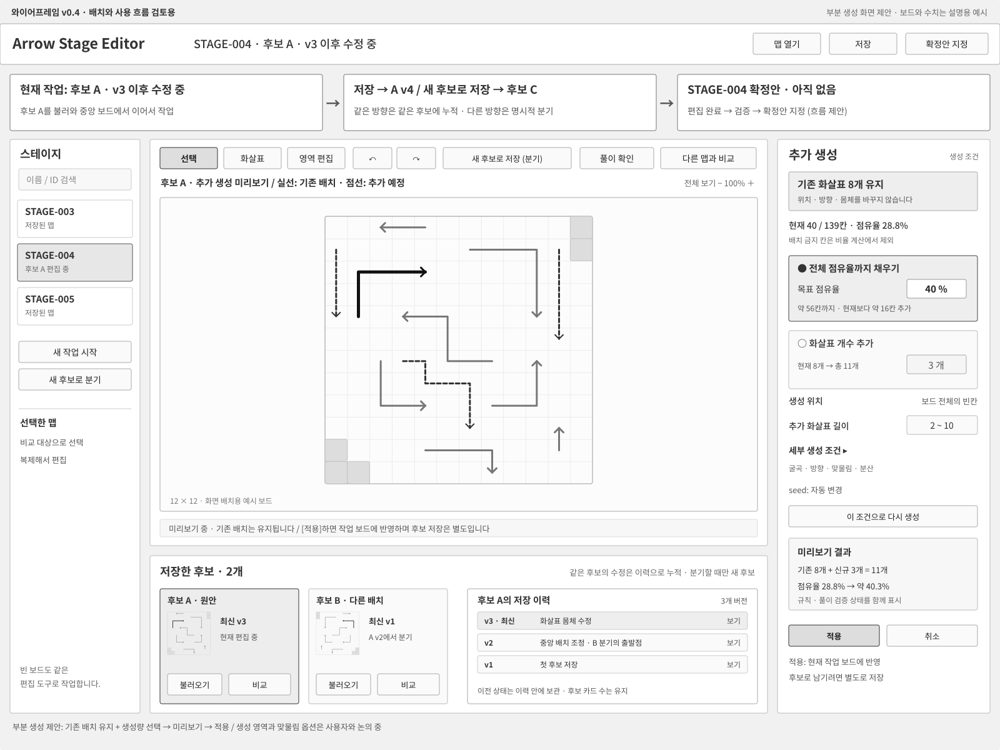

# 스테이지 제작 도구 — 2단계 기획과 와이어프레임

상태: 권장안을 첫 구현 기준으로 채택 / 확실한 편집·저장·검증부터 실제 앱 구현, 고급 조건·운영 계약은 후속 구체화

최근 반영: 2026-10-20 / v0.8 기능 구성 유지, Discord v0.10을 현재 외관 기준으로 채택 / 기능·데이터 계약 미정 항목은 유지

전체 단계 기준: [전체 진행 문서](stage_editor_roadmap.md).

최신 실제 산출물은 [첫 구현 기록](stage_editor_first_build.md)과 [실행 안내](../tool/README.md)입니다. 아래 목업 이력과 실제 앱의 완료 범위를 혼동하지 않습니다. 사용자는 권장안을 우선 구현하고 모호한 부분은 다음 개발로 남기도록 승인했습니다.

## 진행 방식

사용자의 작업 방식을 질문과 토론으로 정하고, 화면은 와이어프레임 수준의 목업으로 확인합니다. 목업은 배치·조작·화면 전환을 검토하기 위한 것으로, 실제 생성·검증·저장 기능의 구현 완료를 의미하지 않습니다.

1. 가장 자주 하는 제작 작업과 후보 검토 방식을 정합니다.
2. 답변에 맞춰 첫 화면의 와이어프레임을 제시하고 배치를 조정합니다.
3. 화살표 편집, 생성 옵션, 분석·풀이 확인의 사용 흐름을 구체화합니다.
4. 고정·무작위 스테이지의 역할과 저장·게임 반영 정책을 정합니다.
5. 정상 작업과 오류·미저장 상태를 목업에서 확인하고 기획을 확정합니다.

질문은 화면이나 동작을 바꾸는 결정부터 묶어서 진행합니다. 앞서 제시한 권장안은 답변으로 확정하기 전까지 제안으로 기록합니다.

현재 남은 결정의 항목별 권장안: [2단계 결정 목록](stage_editor_decisions.md). A는 수치 기준으로 정리 방향을 확인받았고, B1은 머리부터 몸체를 그린 뒤 점과 방향을 수정하는 방식으로 확인했습니다. B의 나머지 조작과 C의 확정·게임 반영은 검토 전 제안입니다. 실제 목표값과 세부 판정식은 별도로 구체화합니다. 이미 승인한 외관·후보 저장 방식은 다시 선택하지 않습니다.

## 이미 확정된 방향

- 게임은 Godot + GDScript를 유지합니다.
- 제작 도구는 동일 저장소의 독립 Electron + React + TypeScript 앱입니다.
- 규칙의 최종 판정은 공용 Godot 코어가 담당합니다.
- 운영 원본은 로컬 제작으로 단계적으로 전환합니다.
- 화면 구성과 사용 흐름은 2단계에서 목업으로 구체화합니다.
- 와이어프레임은 기능·배치 기준이며 그대로 최종 외관으로 구현하지 않습니다. 별도 시각 디자인을 확인한 뒤 실제 앱에 적용합니다.
- 실제 도구 개발환경·기본 연결은 3단계, 생성·분석 연결은 4단계, 편집·저장·게임 반영은 5단계입니다.

## 사용자 답변으로 확정한 제작 방식

- 중앙 보드에서 자동 생성과 직접 화살표 배치를 반복하고, 남겨둘 만한 작업 상태를 사용자가 후보로 저장하는 흐름을 중심으로 합니다.
- 생성 한 번을 후보 하나로 자동 등록하는 것을 기본 동작으로 두지 않습니다.
- 한 번에 맵을 완성하지 않고, 부분 작업을 저장·재개하거나 다른 방향으로 분기하여 진행합니다.
- 기존 배치를 유지하며 남은 부분을 자동 생성하는 기능을 주된 작업 방식으로 지원합니다.
- 생성할 양은 사용자가 정하며 퍼센트와 개수를 기본 입력으로 제공합니다. 세부 의미와 추가 옵션은 계속 구체화합니다.
- 특정 영역 안에서 생성량을 지정하고, 맞물림·연쇄·현재 제거 가능한 화살표 수를 제어할 수 있어야 합니다.
- 현재 맵의 난이도 특성을 수치로 분석하고 생성 목표와 실제 결과를 확인할 수 있어야 합니다.
- ‘풀이 가능 개수’는 현재 시점에서 바로 제거할 수 있는 화살표 수입니다. 같은 집합에서 막힌 수는 전체 수에서 제거 가능한 수를 뺀 값으로 함께 표시할 수 있습니다.
- 빈 보드에서 화살표를 배치하는 작업도 같은 편집 기능으로 처리합니다. 생성한 보드와 빈 보드에 별도 편집기를 만들지 않습니다.
- 기본 작업 공간은 한 맵을 크게 보는 방식입니다.
- 다른 맵과의 비교, 맵 복제는 필요한 기능으로 포함합니다.
- 여러 번의 생성은 사용자가 조건·결과를 보며 반복하는 작업입니다. 대량 자동 생성 기능을 확정한 것은 아닙니다.

## 확정된 후보 저장 기준

사용자가 같은 후보 안에서 수정 이력을 쌓고, 다른 방향으로 분기할 때만 명시적으로 새 후보를 만드는 방식에 동의했습니다.

- 처음 작업을 후보로 저장하면 새 후보를 만듭니다.
- 기존 후보를 불러와 작업하고 저장하면 같은 후보의 최신 상태를 갱신하고, 이전 저장 상태는 후보 내부의 이력으로 보관합니다.
- 같은 후보를 저장할 때 후보 목록의 카드 수는 늘어나지 않습니다.
- 다른 방향으로 작업을 나누려면 ‘새 후보로 저장’을 선택합니다. 출발 후보를 유지하고 별도 후보를 만듭니다.
- 랜덤 생성이나 개별 편집 동작만으로 후보 카드를 자동 추가하지 않습니다.

후보는 하나의 작업 방향이며, 버전은 그 후보의 저장 이력입니다. 이력의 표시·비교·복원 조작, 보관 한도, 실제 파일 형식은 후속 설계 대상입니다.

## 결정 기록

| 항목 | 현재 상태 |
|---|---|
| 주된 제작 흐름 | 사용자 설명 반영: 중앙 보드에서 생성·편집 → 필요할 때 후보 저장 → 후보를 다시 열어 후속 작업 |
| 빈 보드 제작 | 확정: 같은 편집 기능으로 지원 |
| 후보 검토 공간 | 확정: 한 맵 집중을 기본으로 하며 다른 맵과의 비교도 지원 |
| 맵 복제 | 확정: 전체 맵 복제 지원 / 선택 화살표·영역 복사 범위는 후속 확인 |
| 기본 화면 배치 | 사용자 요청 반영: 작업 보드와 세 조건 요약을 함께 표시 / 상세 입력은 팝업 제안 / 아래 후보·버전 이력 유지 |
| 스테이지 목록·순번 | 사용자 요청 반영: 1~N 목록과 순번 관리 진입점 유지 / ID와 순번을 구분하며 조작·반영 계약은 후속 설계 |
| 시각 디자인 | 사용자 승인: Discord v0.10을 현재 외관 기준으로 채택 / 전체 기능 정의·구현 착수 승인과 구분 |
| 비교 화면 | v0.1 제안: 필요할 때 두 보드 비교 화면으로 전환 |
| 후보와 수정 이력 | 확정: 후보는 작업 방향 하나, 버전은 같은 후보의 저장 이력 / 별도 분기는 ‘새 후보로 저장’ |
| 작업본 버전 보관 | 확정: 같은 후보에 저장 이력 누적, 이전 상태 보관 / 구체적인 이력 조작·보관 한도는 후속 설계 |
| 부분 작업의 의미 | 확정: 기존 배치를 유지하고 남은 부분을 랜덤 생성하거나 직접 배치하는 점진적 제작 |
| 기본 생성량 | 영역 안에서 퍼센트·개수 지정 지원은 확정 / 선택 범위의 최종 점유율과 이번 실행의 실제 추가 수로 제안 |
| 생성 영역·맞물림 조건 | 영역 제한·맞물림·연쇄 제어 필요성은 확인 / 세부 조건은 계속 구체화 |
| 제거 가능한 수의 의미 | 확정: 현재 보드에서 즉시 제거 가능한 화살표 수 / 막힌 수도 함께 표시 |
| 전체·영역 목표의 관리 | v0.6 제안: 전체 목표를 기본으로 두고 영역 제약은 필요할 때 추가 / 전체 보드 상태에서 함께 집계 |
| 맵 난이도 수치 분석 | 통합 점수가 아닌 요소별 목표·빈도·커버리지 관리 / 현재 상태와 풀이 흐름의 결과를 구분 |
| 맵에 보존할 설계 조건 | 풀이 가능 수·연쇄·영역 개방을 핵심으로 확장 / 직접 지정·스테이지별 자동 조정의 세부 계약은 후속 확인 |
| 화살표의 배치 역할 | 사용자 제안 반영·검토 중: 선택지 억제, 연쇄 연결, 영역 관문 / 효과 기준과 첫 버전 범위는 미확정 |
| 화살표·보드 편집 조작 | B1 확인: 머리 칸 먼저 지정 → 몸체 그리기 → 완성 후 점·방향 수정 / 영역 등 나머지 조작은 후속 토론 |
| 생성 옵션의 기본·고급 구분 | 후속 토론 |
| 분석·풀이 확인 방식 | 후속 토론 |
| 고정·무작위 스테이지의 최종 역할 | 후속 토론 |
| 초안 저장·검증·게임 반영 절차 | 후보 저장·분기 기준은 확정 / 확정안 지정·게임 반영 조건은 후속 토론 |

## 목업 기록

현재 채택한 시각 디자인: [Discord 스타일 v0.10](design/arrow-editor-v10.html) / [작업 화면 PNG](design/arrow-editor-v10-workspace.png). 이전 [Figma 스타일 v0.9](design/arrow-editor-v09.html)는 비교용입니다. 적용 기준과 한계는 [시각 디자인 문서](stage_editor_visual_design.md)에 기록합니다.

현재 작업 화면: [v0.8 PNG](wireframes/11-workspace-v08.png) / [SVG 원본](wireframes/11-workspace-v08.svg) / [설정 팝업 열기](wireframes/11-workspace-v08.html).

부분 생성 기준과 추가 옵션: [부분 생성 — 양과 보존 기준](stage_editor_generation.md).

부분 생성 화면: [v0.4 PNG](wireframes/05-partial-generation-v04.png) / [SVG 원본](wireframes/05-partial-generation-v04.svg).

영역·밸런싱의 현재 관리안: [v0.6 PNG](wireframes/07-balancing-scope-v06.png) / [SVG 원본](wireframes/07-balancing-scope-v06.svg).

최신 통합 정리와 작업+조건 목업: [맵의 난이도 구성 조건](stage_editor_difficulty_profile.md) / [v0.8 목업 열기](wireframes/11-workspace-v08.html).

상세 기준: [밸런싱 제어와 맵 분석](stage_editor_balancing.md), [화살표 배치 역할 초안](stage_editor_arrow_roles.md).

이전 목업은 검토 이력으로 보존합니다. v0.1~v0.2의 ‘생성할 때마다 후보 추가’ 제안은 현재 확정된 저장 기준에서 제외했습니다. 아래 과거 기록의 미확정 표시는 해당 목업을 검토하던 시점의 상태이며, 현재 기준은 위 확정 사항과 결정 기록을 따릅니다.

### v0.1 — 기본 작업 화면과 두 맵 비교

- [기본 작업 화면 PNG](wireframes/01-workspace.png) / [SVG 원본](wireframes/01-workspace.svg)
- [두 맵 비교 화면 PNG](wireframes/02-compare.png) / [SVG 원본](wireframes/02-compare.svg)

표시된 보드·ID·수치·선택 상태는 배치 설명용 예시입니다. 실제 생성이나 판정을 실행한 결과가 아니며, 목업의 버튼은 동작하지 않습니다.

배치 제안:

- 왼쪽에는 저장된 스테이지 목록과 빈 보드·현재 맵 복제 진입점을 둡니다.
- 중앙은 현재 편집본 하나를 크게 표시하고, 선택·화살표·영역 편집과 풀이 확인을 연결합니다.
- 아래에는 생성 후보를 두어 이전 결과를 다시 보고, 원본을 보존한 채 복제하여 편집할 수 있게 합니다.
- 오른쪽에는 생성 조건, 선택 화살표의 속성, 검증·분석을 배치합니다. 기본·고급 옵션의 구분은 아직 예시입니다.
- 비교할 때는 두 보드를 나란히 표시하고, 어느 맵을 기반으로 편집할지 선택하도록 제안합니다.

작업 보존을 위한 제안:

- 재생성 결과는 별도 후보로 추가하고 현재 편집본을 자동으로 덮어쓰지 않습니다.
- 후보에서 편집을 시작하거나 저장된 맵을 복제하면 원본과 별도인 편집본을 만듭니다.
- 비교 화면은 우선 확인·선택용으로 두고 실제 수정은 기본 편집 화면에서 진행하도록 제안합니다.
- 후보의 보관 개수·앱 종료 후 유지 여부, 복제본의 ID·저장 방식은 후속 토론에서 확정합니다.

다음 확인 사항:

1. 오른쪽의 생성 조건·속성·분석을 함께 표시할지, 탭으로 나눌지.
2. 복제 범위에 전체 맵 외에 선택한 화살표나 영역의 복사도 포함할지.
3. 화살표의 머리·방향·몸체를 만들고 수정하는 구체적인 조작.
4. 저장·게임 반영 버튼의 의미와 고정·무작위 모드의 최종 역할.

화면에 표현한 초안 저장·게임 반영, 되돌리기, 개별 화살표 복제 등의 조작은 현재 배치 제안이며 기능 범위를 확정한 것으로 취급하지 않습니다.

### v0.2 — 생성 결과·편집본·확정안의 관계

사용자 피드백: 생성 후보가 수정 백업처럼 보이고, 어떤 맵을 최종 확정하는지 v0.1에서 확인하기 어렵습니다.

구분한 개념:

| 구분 | 의미 | 목업의 예시 |
|---|---|---|
| 생성 결과 | 자동 생성을 한 번 실행해서 얻은 원본 맵 | C001~C004는 네 번 실행한 결과 |
| 편집본 | 선택한 생성 결과나 기존 맵을 기반으로 다듬는 맵 | C003을 바탕으로 만든 편집본 01 |
| 작업본 저장 이력 | 편집 중인 맵의 이전 상태를 보관하는 기능 | 버전 보관 여부를 질문 중이며 아직 확정하지 않음 |
| 확정안 | 해당 스테이지에서 최종 선택한 맵 | STAGE-004의 확정안은 아직 없는 예시 |

이번 목업에서 제안한 흐름은 생성 결과 → 선택·복제 → 편집본 → 검증 → 확정안 지정입니다. 수정 없이 생성 결과를 채택할 때도 같은 흐름을 사용하되 편집 단계에서 변경할 필요는 없습니다.

수정한 화면:

- 상단에 생성 결과, 현재 편집본의 출처, 해당 스테이지의 확정안 유무를 표시했습니다.
- 아래 목록을 ‘자동 생성 결과 · 4회 생성’으로 바꾸고, 서로 다른 보드 미리보기를 넣었습니다.
- C003이 현재 편집본의 원본임을 표시했습니다.
- 작업본 저장과 확정안 지정을 별도 버튼으로 제안했습니다.
- 확정안 지정과 실제 게임 반영의 관계는 후속 토론에서 정합니다.

상단 관계 표시는 개념을 확인하기 위한 와이어프레임 제안입니다. 실제 화면에서의 크기·접기 여부, 수정본의 버전 보관 방식, 검증 실패 시 확정 처리 규칙은 아직 미확정입니다.

### v0.2 이후 논의 — 후보 저장과 수정 이력의 기준

사용자 피드백:

- 중앙 보드에서 랜덤 생성·직접 배치를 하다가 괜찮은 상태를 후보로 저장합니다.
- 후보를 불러와 부분 작업을 이어갈 수 있어야 합니다.
- 같은 후보를 수정한 후 덮어쓸지, 새 후보로 만들지 기준이 필요합니다.
- 저장마다 새 후보를 만들면 목록이 너무 많아지므로 작업 방향과 수정 이력을 구분할 필요가 있습니다.

제안 중인 기준:

| 작업 | 후보 목록 | 수정 이력 |
|---|---|---|
| 새 작업에서 처음 ‘후보로 저장’ | 새 후보 A 생성 | A의 첫 저장 상태 |
| 후보 A를 불러와 수정한 뒤 ‘저장’ | 같은 후보 A의 최신 상태 갱신 | A 안에 이전 저장 상태 보관 |
| A에서 다른 방향으로 ‘새 후보로 저장’ | 별도 후보 B 생성 | B의 첫 저장 상태, A에서 시작했다는 출처 보존 |
| ‘새 작업’으로 처음부터 다시 시작 | 기존 후보 유지, 현재 보드는 새 작업 | 이후 후보로 저장할 때 새 후보 생성 |
| 저장 없이 생성·편집을 반복 | 후보를 자동 추가하지 않음 | 생성·수정마다 저장 버전을 자동 추가하지 않음 |

이 안에서는 후보 목록에 A, B 같은 작업 방향만 보이고, A의 여러 수정 상태는 A의 이력에서 확인합니다. 화면의 기본 조작은 ‘저장’과 ‘새 후보로 저장’을 구분합니다. 최종 확정안은 선택한 후보의 특정 저장 상태를 가리키는 방향으로 제안하며, 게임 반영 정책은 후속 논의 대상입니다.

후보 저장은 부분 작업을 보존하는 용도이므로 완성도·생성 목표·클리어 가능성 통과를 저장 조건으로 두지 않는 방향을 제안합니다. 검증 상태는 함께 표시하되 정식 확정·게임 반영 조건과 구분합니다. 후보 파일의 구조상 안전한 저장 조건과 빈 보드 처리 계약은 이 정책을 확정한 뒤 설계합니다.

아직 이 저장 기준을 확정하지 않았습니다. 앞서 제시한 ‘저장할 때마다 버전을 남길지’라는 질문도 후보 목록을 늘리는 문제와 구분해서 다시 확인합니다.

부분 생성에 대한 확인:

- 현재 생성 API에는 기존 화살표를 받아 유지하는 입력이 없습니다.
- ‘부분 작업’이 이미 만든 부분을 고정하고 나머지를 자동 생성하는 의미라면 생성 기능의 추가 요구사항으로 구체화해야 합니다.
- 수동으로 나누어 수정하고 저장·재개하는 의미라면 우선 저장·편집 흐름으로 지원할 수 있습니다.
- 사용자 답변 전에는 부분 생성 기능을 확정 범위로 추가하지 않습니다.

### v0.3 — 후보별 저장 이력과 명시적 분기

사용자 결정: 하나의 후보 안에서 작업을 누적하고 저장 이력을 남깁니다. 다른 방향으로 분기한다고 판단할 때만 명시적으로 새 후보를 만듭니다.

- 후보 A를 불러와 수정 중인 화면을 표시했습니다.
- ‘저장’은 A의 다음 버전을 만들고, ‘새 후보로 저장’은 별도 후보를 만드는 것으로 구분했습니다.
- 아래 영역을 자동 생성 결과 목록에서 ‘저장한 후보’와 ‘선택한 후보의 저장 이력’으로 변경했습니다.
- 예시에서는 후보 A에 v1~v3가 있으며, 후보 B는 A v2에서 분기한 별도 작업 방향입니다.
- 후보 수와 버전 수를 별도로 보여 저장을 반복해도 후보 목록이 늘어나지 않는 관계를 표현했습니다.

저장 의미는 확정했으며, 패널 배치·표시 크기·이력 조작은 목업 제안입니다. 이 목업 작성 시에는 기존 화살표를 고정한 부분 자동 생성 여부와 확정안·게임 반영의 관계를 아직 정하지 않았습니다.

### v0.4 — 기존 배치를 유지하는 부분 생성

사용자 결정: 기존 상태를 유지하고 그 후를 랜덤 생성하거나 직접 배치하는 경우가 주된 작업입니다. 랜덤 생성할 양을 사용자가 퍼센트와 개수로 정할 수 있어야 하며, 이후 세부 생성 옵션을 확장합니다.

목업에서 제안한 기준:

- 기존 화살표의 위치·방향·몸체를 유지하고 추가분을 구분합니다.
- ‘전체 점유율까지 채우기’와 ‘화살표 개수 추가’ 중 생성량 기준을 선택합니다.
- 점유율은 기존 배치를 포함한 전체 사용 가능 칸 기준이며, 개수는 이번 실행의 실제 추가 수로 제안합니다.
- 예시에서는 기존 8개·40칸을 유지하고, 139칸 중 목표 약 40%까지 추가하는 미리보기를 표시했습니다.
- ‘적용 / 다시 생성 / 취소’로 추가분을 검토한 뒤 현재 작업에 반영하는 방식을 제안합니다.
- 후보 저장과 분기는 기존에 확정한 별도 조작으로 유지합니다.

기존 화살표는 실선, 추가 예정 화살표는 점선으로 구분했습니다. 보드·수치·추가 결과는 설명용 예시이며 실제 생성·분석 결과가 아닙니다. 이 화면은 생성 조건에 집중한 상태를 표현하며 기본 화면의 속성·분석 패널 배치까지 확정한 것은 아닙니다.

확인 중인 사항은 생성할 영역을 직접 지정할지, 기존 화살표와의 맞물림 관계를 생성 조건으로 제어할지입니다. 자세한 의미·예외·현행 구현과의 차이는 부분 생성 문서에서 관리합니다.

### v0.5~v0.6 — 영역 제약과 전체 맵 목표의 관리

사용자가 영역 생성과 맞물림·연쇄·제거 가능한 수의 제어, 맵 자체의 수치 분석이 필요함을 확인했습니다. ‘풀이 가능 개수’는 현재 상태에서 바로 제거할 수 있는 화살표 수로 확정했습니다.

- [v0.5 영역 생성과 밸런싱 PNG](wireframes/06-region-balancing-v05.png) / [SVG 원본](wireframes/06-region-balancing-v05.svg)
- [v0.6 전체·영역 목표 관리안 PNG](wireframes/07-balancing-scope-v06.png) / [SVG 원본](wireframes/07-balancing-scope-v06.svg)

v0.6은 선택 영역이 생길 때 목표 관리가 복잡해진다는 사용자 의견에 대한 제안입니다.

- 새 화살표는 선택 영역에 배치하고 기존 배치를 유지합니다.
- 기본 목표는 전체 맵에 두고, 중간 제작에서는 목표와 현재 값의 차이를 표시합니다.
- 이번 생성에서 지킬 조건을 별도로 두고, 영역별 제약은 필요할 때 추가합니다.
- 선택 영역과 전체 맵의 제거 가능 수·막힌 수를 전체 보드의 실제 막힘 관계에서 집계합니다.
- 영역 소속은 화살표 머리 위치, 점유율은 영역 안 몸체 칸 수로 계산하는 기준을 제안합니다.
- 후보·이력과 현재 맵 분석을 오갈 수 있는 화면을 제안합니다.

화면의 목표 수치·영역 소속 기준·목표 강도와 세부 조작은 아직 최종 승인하지 않았습니다. 실제 생성이나 분석 기능은 연결하지 않았습니다.

### 추가 토론 — 역할을 정해 화살표 배치

사용자가 선택지를 현저히 줄이는 화살표, 연쇄를 일으키는 화살표, 영역을 개방시키는 화살표를 정의해 작업 방향별로 배치하는 아이디어를 제안했습니다.

현재는 이를 선택지 억제·연쇄 연결·영역 관문이라는 제작 역할 초안으로 정리합니다. 단일 화살표가 여러 역할을 가질 수 있고, 역할 이름만 지정한 상태와 실제 효과를 검증한 상태를 구분합니다. 구체적인 역할·지표·생성 조작은 후속 토론에서 정합니다.

상세 내용은 [화살표 배치 역할 초안](stage_editor_arrow_roles.md)에 기록합니다.

### v0.7 — 늘어난 설계 요소의 통합과 화면 분리

사용자는 순간 판정만으로 부족하므로 맵 차원에서 영역·선행 관계·역할을 보존하고, 풀이 가능 수·연쇄 단계·영역 개방의 목표·빈도·커버리지를 별도 관리하는 방향을 확인했습니다. 통합 난이도 점수를 기본으로 삼지 않습니다. 직접 지정과 스테이지별 자동 조정, 이후 요소의 같은 방식 확장을 요구하며 구체적 수치는 예시입니다.

화면 제안은 작업·맵 조건·분석의 세 부분입니다. 기본 작업 화면에서 모든 상세 조건을 동시에 펼치지 않고, 필요할 때 설정 또는 결과 화면으로 이동합니다. 기존 후보 저장·이력·분기·비교·복제·부분 생성은 유지합니다.

- [화면 전환 목업](wireframes/08-difficulty-v07.html)
- [작업 화면 PNG](wireframes/08-difficulty-workspace-v07.png)
- [맵 조건 화면 PNG](wireframes/09-difficulty-profile-v07.png)
- [분석 화면 PNG](wireframes/10-difficulty-analysis-v07.png)

보드 예시는 실제 Godot 코어로 검증한 작은 관문 맵을 사용합니다. 입력·저장·생성은 미구현이며 화면 배치와 상세 단위도 아직 승인 전입니다. 반복 압박의 발생 빈도나 모든 풀이 경로까지 검증한 것으로 취급하지 않습니다. 상세 결정·미정 사항·재검증 근거는 [통합 정리](stage_editor_difficulty_profile.md)를 따릅니다.

### v0.8 — 작업과 핵심 조건을 함께 보고, 상세 입력은 팝업으로

사용자는 작업과 맵 조건을 분리하지 않고 함께 보기를 요청했습니다. 최소한 핵심 세 조건의 수치는 작업 중 조회할 수 있어야 하며, 상세 설정·변경은 팝업이나 별도 창으로 분리할 수 있습니다. 또한 v0.7에서 설명상 축약한 스테이지 1~N 목록과 순번 관리가 기본 작업 공간에 필요함을 확인했습니다.

- [화면 전환·설정 팝업 목업](wireframes/11-workspace-v08.html)
- [작업+세 조건 요약 PNG](wireframes/11-workspace-v08.png) / [SVG](wireframes/11-workspace-v08.svg)
- [상세 설정 팝업 PNG](wireframes/13-profile-dialog-v08.png)
- [스테이지 목록을 유지한 분석 PNG](wireframes/12-analysis-v08.png) / [SVG](wireframes/12-analysis-v08.svg)

왼쪽 스테이지 순번·ID·검색·추가·복제·위/아래 이동 진입점, 중앙 보드·후보·버전 이력, 오른쪽 세 조건 요약과 선택 화살표를 배치했습니다. 현재 값·목표·검증 결과를 구분하고 빈도·커버리지가 미설정인 경우 수치를 만들어 넣지 않습니다. 상세 입력은 팝업으로 옮겼습니다.

실제로 동작하는 것은 작업/분석 화면 전환과 상세 설정 팝업 열기·닫기입니다. 목록·후보·순번·입력은 정적 예시이며 스테이지 선택·순서 변경·설정 변경·저장 기능을 구현한 것은 아닙니다. 스테이지 순서와 ID를 분리하는 계약 및 미저장 상태의 전환 처리는 후속 확인 대상입니다.

검증: SVG 두 화면을 PNG로 렌더링해 배치를 확인했고, 브라우저에서 조건 요약·스테이지 목록 유지, 작업/분석 전환, HTML·SVG 버튼의 팝업 열기/닫기와 키보드 진입을 확인했습니다. 팝업 PNG는 브라우저에서 실제 열린 상태를 캡처했습니다. 게임 코드와 규칙은 변경하지 않았습니다.
